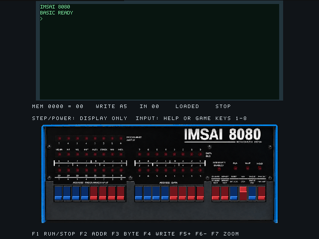
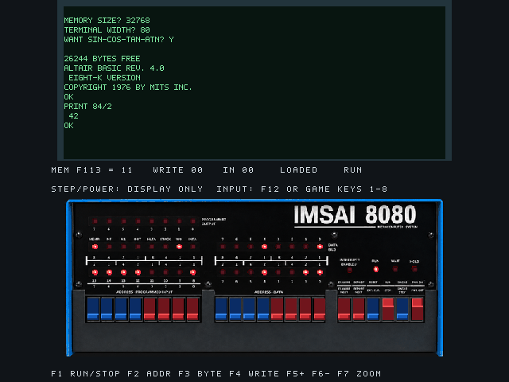
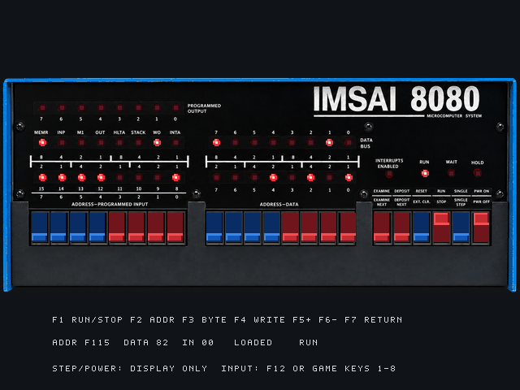
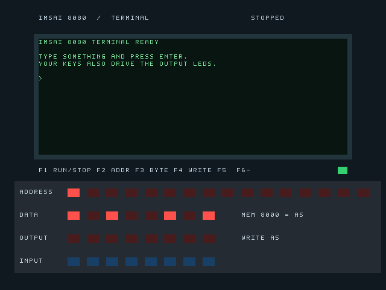
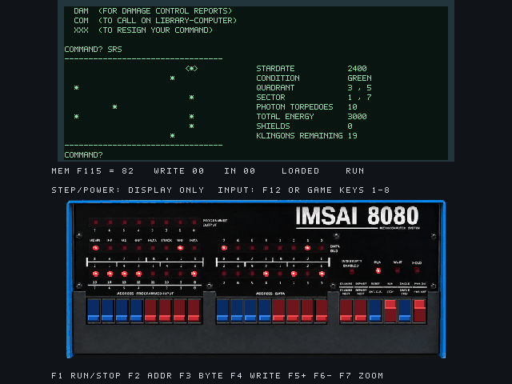
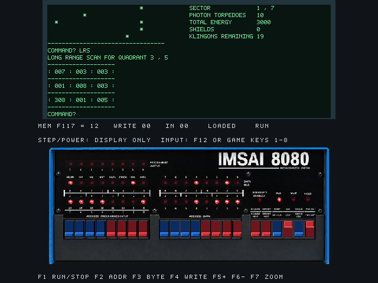

# IMSAI 8080 for MiSTer and MEGA65

The computer featured in **WarGames (1983)**, brought to MiSTer and MEGA65 as FPGA cores with an 8080 CPU, 64 KiB RAM, a green terminal and an interactive virtual front panel. [Historical background: Computer History Museum](https://www.computerhistory.org/revolution/artifact/297/1153?position=0).

**Discussion and test reports:** [IMSAI 8080 on MiSTer FPGA Discord](https://discord.com/channels/647909397477195803/1563303117947277443) (Discord account/server access required).

## Start here — complete MiSTer installation

1. [Download the complete MiSTer ZIP](https://github.com/toby01019/IMSAI8080-MiSTer/releases/download/mister-downloader-20261028-games/IMSAI8080-MiSTer-Downloader-20261028-games.zip) and extract it on your computer.
2. Copy the **contents of SD** to the root of the MiSTer SD card, merging `_Computer`, `games` and `docs`. Preserve customized files and existing cores.
3. Start **Computer → IMSAI8080 - Terminal (Updater)** or one of the included program entries.

The current package is ready for manual installation. Automatic installation through Update All is **requested, not yet accepted**: [request #21](https://github.com/theypsilon/MultiDatabases_MiSTer/pull/21). The prepared database uses the official MiSTer Downloader; no separate installer is required. Older releases are retained as archives for existing links and rollback.

## Games and applications

- **Super Star Trek** — based on Mike Mayfield’s *Star Trek* (1971), expanded by Bob Leedom in 1974 and popularized through David H. Ahl’s *BASIC Computer Games*. This version uses the May 1978 BASIC listing.
- **Kill the Lights** — use the front-panel input switches to turn off all the LEDs.
- **Tiny BASIC and BASIC 4.0** — write and run your own programs.
- Terminal, memory inspection/editing, RUN/STOP and input/output tests.

## What’s new — 23 October 2026

This updates the earlier releases: the terminal and redesigned front panel now share one screen. **F7** enlarges the panel and returns without losing terminal text or program state. Live status/address/data lamps and existing controls are retained; illustrated English guides are included. **MEGA65 v0.3.0 updates v0.2.1.**

The current complete MiSTer and MEGA65 packages include the games, BASIC program files and English documentation. No earlier installation is required. Preserve customized files when merging folders.

## MEGA65 R3 and R6 front-panel update

These are **simulation renders**, not hardware captures. R6 passed short display, F7, RUN/STOP, memory and Tiny BASIC checks on Toby’s MEGA65 on 23 October 2026. **Version 0.3.0 was successfully tested on a physical MEGA65 R3 by a community user on 27 October 2026, explicitly including F7 zoom.** R3A and a detailed per-function R3 checklist remain unconfirmed.

- [Complete R3/R6 packages and English guides on the MEGA65 Filehost](https://files.mega65.org?id=805eb9b2-856c-47e8-87ca-2ba921ec94a0) — Filehost 1.8: R3; 1.9: R6.
- [MEGA65 R3 guide](MEGA65-R3-GUIDE.md) · [R6 guide and hardware results](MEGA65-R6-GUIDE.md)
- [Downloads on itch.io](https://toby01019.itch.io/imsai8080-mister)

Choose the build matching your board; R3/R6 files are not interchangeable. The complete packages include `SD/IMSAI` with the BIN files. Copy the contents of `SD` to the card root, preserving customized files and a rollback core; preserve the factory/main core. HELP opens the program loader. Full installation instructions are in the guides.

## MiSTer views

These screenshots show **actual MiSTer output**. The panel artwork is an AI-assisted interpretation of a reference photograph.

## Download and installation

- [Complete MiSTer release](https://github.com/toby01019/IMSAI8080-MiSTer/releases/tag/mister-downloader-20261028-games): download **IMSAI8080-MiSTer-Downloader-20261028-games.zip**.
- [itch.io downloads and offline guides](https://toby01019.itch.io/imsai8080-mister).
- Repository files: [dated core](IMSAI8080_20261023.rbf), seven `IMSAI8080 Update - ...mgl` launch entries and [build sources](Sources.zip).

Requires **MiSTer hardware**. No previous IMSAI installation, BIOS files or MiSTer.ini changes are required. Extract the ZIP and copy the **contents of SD** to the SD-card root: `_Computer`, `games` and `docs`. Start **Computer → IMSAI8080 - Terminal (Updater)** or one of the six program entries. Preserve customized files and older cores as fallback. The package uses separate updater-specific names and configuration.

## Controls

F1 RUN/STOP; F2 address; F3 byte; F4 write; F5/F6 next/previous address; **F7 combined/enlarged view**; F12 MiSTer menu. Memory controls work while stopped. See [USER_GUIDE.md](USER_GUIDE.md) for MiSTer controls and the board-specific guides for MEGA65 keys.

## Hardware checks

Short MiSTer checks passed for both views/F7, terminal input, RUN/STOP, memory editing, BASIC arithmetic, LED-game input and Star Trek SRS/LRS scans. **A complete Star Trek mission has not been tested.**

## Limits and credits

Known limitations: STEP, POWER and execution from the examined address are not implemented. Keyboard punctuation/Ctrl-C remain incomplete. Reported constrained MiSTer timing paths pass; incompletely constrained requirements remain. Detailed results are in the guides and build reports.

Project by Toby, developed with assistance from OpenAI Codex. Component authors and licenses: [CREDITS.md](CREDITS.md), [Sources.zip](Sources.zip) and [licensing notes](SOURCES_AND_LICENSING.md). Historical programs are separate works.

Feedback and hardware test reports are welcome.
