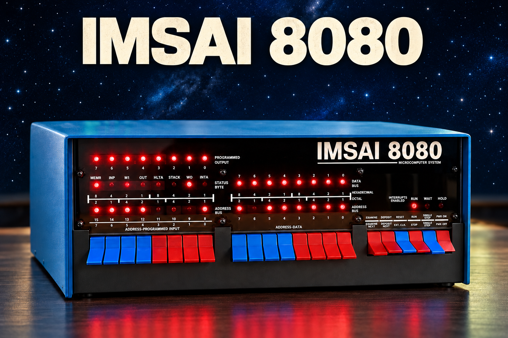
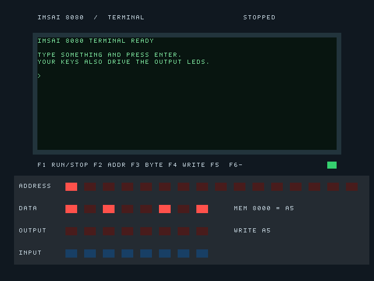
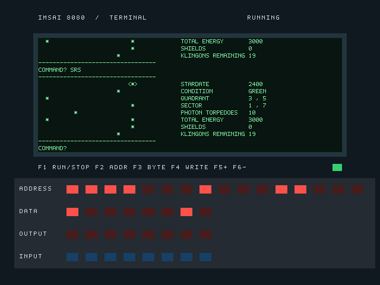

# IMSAI 8080 for MiSTer — Prototype

**Build 1 October 2026 · MiSTer by Toby**

An experimental IMSAI 8080 FPGA core with a green terminal, a virtual LED front panel and historical programs. The idea came from Toby; development was assisted by OpenAI Codex. See [CREDITS.md](CREDITS.md) for component authors.



*AI-generated illustration of the IMSAI 8080; not an original photograph.*

## Download

Get the complete installation ZIP from [Releases](https://github.com/toby01019/IMSAI8080-MiSTer/releases). The ZIP includes the full source tree and build/test scripts in Sources.

## Install on your MiSTer SD card

1. Extract the complete ZIP on your computer first.
2. Open the extracted package, then its **SD** folder.
3. Copy **_Computer** and **games** to the **top level of the MiSTer SD card**, merging them with the existing folders. On MiSTer this location is `/media/fat`.
4. Preserve your own modified IMSAI files before replacing matching files. Do not replace or remove other cores or games.
5. Do not copy the enclosing package folder or SD folder onto the card. Do not create games/games or _Computer/_Computer.
6. Start MiSTer and select an **IMSAI8080** launch entry in the **Computer** menu.

| In this download | Destination on the SD card |
| --- | --- |
| SD/_Computer/IMSAI8080_20261001.rbf | /_Computer/IMSAI8080_20261001.rbf |
| SD/_Computer/*.mgl (all seven entries) | /_Computer/ (keep their names) |
| SD/games/IMSAI8080/ (complete folder) | /games/IMSAI8080/ |

With a card reader: shut down/power off MiSTer before removing the card; copy the folders, safely eject the card and reinsert it before powering on.

With WinSCP: use your existing authorized MiSTer connection, open **/media/fat** on the remote side, and copy _Computer and games from SD into that directory. Merge folders and review existing matching IMSAI files before replacing them. Restart the selected entry after the transfer.

README, Documentation and Sources stay on your computer; only the contents of SD need copying to MiSTer. Nothing needs flashing into a core slot.

## First checks

- **IMSAI8080 - Terminal:** type HALLO and press Enter. Check the terminal responds.
- **IMSAI8080 - Tiny BASIC:** try `PRINT 84/2` and Enter; expected result: 42.
- **IMSAI8080 - Super Star Trek:** wait for automatic loading and COMMAND?, then try SRS and LRS. Restarting the entry starts over.
- **IMSAI8080 - Kill the Lights:** use keys 1 to 8 for the INPUT switches.

F1 toggles RUN/STOP. F2 selects an address, F3 prepares a byte, F4 writes it while stopped, F5/F6 examine adjacent addresses. F12 opens the MiSTer menu.

## User guide and pictures

After extracting, open **USER_GUIDE.html** in your browser for an offline guide with screenshots. No account or website is needed.

The [Markdown user guide](USER_GUIDE.md) is also included. If your text editor does not follow the link, open the file directly from the Documentation folder.





## Prototype limits and credits

This package contains the tested build of 1 October 2026. The core binary is unchanged. Keyboard punctuation and Ctrl-C support remain incomplete. Panel controls are monitor-style controls, rather than a complete historical CP-A circuit replica. A complete Super Star Trek game has not been tested.

Sources includes the project tree and build/test scripts; installed development tools are excluded. Individual component licenses and attribution remain in the sources and [licensing notes](SOURCES_AND_LICENSING.md). Historical programs are separate works. The bundled Microsoft/MITS BASIC runtime has no established redistribution permission; its provenance notes are retained.

Suggestions, ideas and test reports are welcome.
