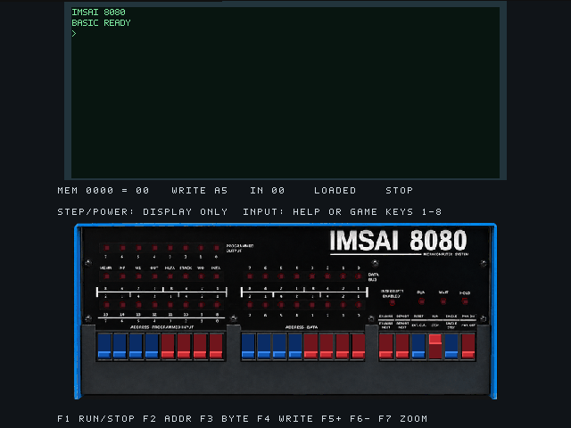
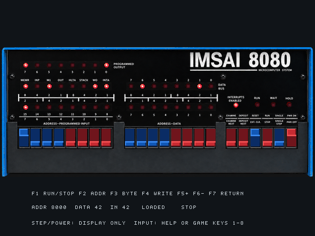
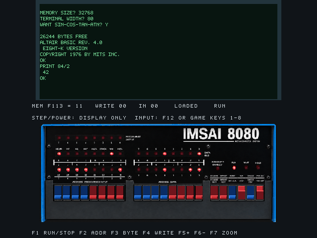
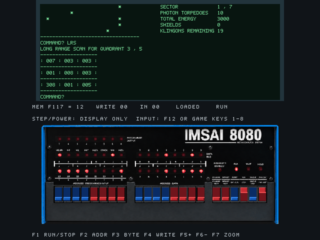

# IMSAI 8080 for MiSTer -- Prototype

**Front-panel update / 23 October 2026 / MiSTer by Toby**

An experimental IMSAI 8080 FPGA core with a green terminal, a virtual LED front
panel and historical programs. The idea came from Toby; development was assisted
by OpenAI Codex. See [CREDITS.md](CREDITS.md) for component authors.

The IMSAI 8080 is the iconic computer featured in **WarGames (1983)**. This project brings an experimental FPGA implementation of that computer to MiSTer. [Historical background: Computer History Museum](https://www.computerhistory.org/revolution/artifact/297/1153?position=0).

## MEGA65 R3 and R6 front-panel update

These two images are rendered from the MEGA65 simulation, not captured from hardware. The R6 hardware test results are documented separately below. The later MiSTer screenshots show MiSTer output.

Separate MEGA65 builds now provide the combined terminal/front panel and F7 enlarged view. **The R6 build passed a short hardware test on Toby's MEGA65 R6 on 23 October 2026.** Both views, F7 text/program retention, RUN/STOP, RAM write/readback and Tiny BASIC loading/arithmetic passed. R3 is built and simulation-checked, but has not been tested on physical R3 hardware.

Use only the file matching your board revision. Requires MEGA65 hardware and the existing `/IMSAI` BIN program files; historical runtime binaries are not included. Keep a known-working rollback core and preserve the factory/main core. On the MEGA65 keyboard, HELP opens the menu; F2/F4/F6 are Shift+F1/F3/F5.

- [MEGA65 R3 guide](MEGA65-R3-GUIDE.md) · [R6 guide and hardware results](MEGA65-R6-GUIDE.md)
- [Download R3/R6 update packages, sources and English guides](https://github.com/toby01019/IMSAI8080-MiSTer/releases/tag/mega65-20261023-frontpanel)
- [Downloads on itch.io](https://toby01019.itch.io/imsai8080-mister)

## What's new

- Terminal (80 columns x 16 rows) and the smaller front panel share one screen.
- **F7** enlarges the front panel; press F7 again to return. Program execution and
  terminal contents continue across view changes.
- Original-style artwork with live output, CPU-status, address and data lamps.
- Existing RUN/STOP, memory controls and LED-game inputs are retained.

The panel artwork is an AI-generated interpretation of a reference photograph,
not a scan of an original faceplate. The screenshots show the actual FPGA output.
STEP and POWER are displayed but have no implemented action.

## Download and installation

Download the English update package and offline guide on **[itch.io](https://toby01019.itch.io/imsai8080-mister)**. Requires MiSTer hardware and your existing IMSAI8080 program files.

Download **IMSAI8080-MiSTer-Update-20261023.zip** from
[Releases](https://github.com/toby01019/IMSAI8080-MiSTer/releases).
The same [dated core](IMSAI8080_20261023.rbf) and seven `IMSAI8080 Update - ...mgl` launch entries
are available directly in this repository; [build sources](Sources.zip) are included.

This is an update for an existing installation. It does **not** bundle historical
program runtimes. The launch entries reuse your existing `/games/IMSAI8080` files.

1. Extract the ZIP on your computer.
2. Copy the contents of `SD/_Computer` into `/_Computer` on the MiSTer SD card.
3. Keep `IMSAI8080_20261001.rbf` and your old launch entries as a fallback.
4. Start an **IMSAI8080 Update - ...** entry from the Computer menu.

The new core is `IMSAI8080_20261023.rbf`. Its launch entries use a separate
`IMSAI8080_Update20261023` configuration. Do not replace other cores or games.
The Amiga core is unrelated and is not changed by this update.

## Controls

F1 RUN/STOP; F2 address; F3 byte; F4 write while stopped; F5/F6 next/previous
address; **F7 combined/enlarged view**; F12 MiSTer menu. In Kill the Lights,
keys 1-8 control the input switches. See [USER_GUIDE.md](USER_GUIDE.md).

## Hardware checks

On Toby's MiSTer: both views and return switching, terminal echo, STOP/DEPOSIT
(`MEM 8000 = A5`), BASIC (`PRINT 84/2` -> `42`), LED-game input, and Star Trek
short- and long-range scans passed. Terminal contents were preserved across F7.
This does not establish that a complete Star Trek mission has been tested.

Quartus 25.1 build: 10,444/41,910 ALMs (25%), 12,207 registers,
292/553 RAM blocks (53%). Reported constrained paths pass: minimum setup slack
0.451 ns and hold slack 0.246 ns. Quartus still reports incompletely constrained
timing requirements. Simulation regressions and full video-raster checks passed.

## Limits and credits

This remains a development prototype, not a complete historical CP-A circuit
replica. STEP, POWER and starting execution at an examined address are not
implemented. Keyboard punctuation and Ctrl-C support remain incomplete.

Individual component licenses and attribution remain in [Sources.zip](Sources.zip) and
[licensing notes](SOURCES_AND_LICENSING.md). Historical programs are separate works;
this update does not redistribute Microsoft/MITS BASIC runtime images.

Suggestions, ideas and test reports are welcome.
